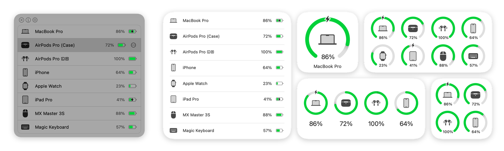

> AirBattery is a fork of [lihaoyun6/AirBattery](https://github.com/lihaoyun6/AirBattery). The maintained fork by [callieskye](https://github.com/callieskye/Air-Battery) helped a lot in bringing it up to date.

<h1 align="center">AirBattery</h1>
<h3 align="center">The battery level of your Mac and every device around it, in the menu bar, the Dock and widgets.</h3>

## Screenshots

<picture>
  <source media="(prefers-color-scheme: dark)" srcset="./img/preview_dark.png">
  <source media="(prefers-color-scheme: light)" srcset="./img/preview.png">
  
</picture>

## Features

- **Devices**
  - This Mac's battery.
  - AirPods and Beats, with the case and each earbud.
  - Bluetooth and BLE mice, keyboards, trackpads and headphones.
  - Logitech devices on Lightspeed, Unifying or Bolt receivers, and Logitech headsets.
  - iPhone, iPad, Apple Watch and Vision Pro over your network, and iPhone or cellular iPad over Bluetooth.
  - Apple Pencil through its iPad.
  - Other Macs and their devices on your network with **Nearcast**.
- **Where it shows up**
  - A menu bar popover, with an optional live battery icon in place of the app icon.
  - The Dock icon and Dock window.
  - Pinned menu bar items for single devices.
  - Desktop widgets.
  - The `airbattery` command line tool and AppleScript.
- **Battery alerts**
  - Low and full alerts for any device.
- **Device list**
  - Hide devices or block them by name.
  - Sort by name or battery level, or drag the list into your own order.
- **Native look**
  - Device icons from the macOS device catalog.
  - The macOS 26 design, while older systems keep their look.

## Installation

AirBattery requires **macOS 13 or later**.

Download the latest notarized build from [Releases](../../releases/latest), unzip it and move `AirBattery.app` to `/Applications`.

To build it yourself:

1. Install Xcode 27 or later.
2. Open `AirBattery.xcodeproj`.
3. Run the `AirBattery` scheme.

## Usage

- AirBattery finds supported devices on its own; there is nothing to pair or configure. The sources it uses can be turned on or off in **Settings > Nearbility**.
- Click the menu bar or Dock icon to see every device, or add an AirBattery widget to your desktop.
- Use the **...** button next to a device to set battery alerts, pin it to the menu bar, copy its name or ID, or hide it.
- Turn on **Nearcast** in Settings, with the same group ID on each Mac, to see your other Macs and their devices.
- Run `airbattery` in Terminal after installing the command line tool from **Settings > General**.

Something not showing up? See [Troubleshooting](./TROUBLESHOOTING.md).

## Third-party components

| Component | License | Use |
| --- | --- | --- |
| [libimobiledevice](https://github.com/libimobiledevice/libimobiledevice), [libplist](https://github.com/libimobiledevice/libplist), [libusbmuxd](https://github.com/libimobiledevice/libusbmuxd), [libimobiledevice-glue](https://github.com/libimobiledevice/libimobiledevice-glue) | LGPL-2.1 | Bundled tools and libraries for iOS devices |
| [OpenSSL](https://github.com/openssl/openssl) | Apache-2.0 | Bundled library used by libimobiledevice |
| [comptest](https://gist.github.com/nikias/ebc6e975dc908f3741af0f789c5b1088) | - | Bundled tool for Apple Watch batteries |
| [Sparkle](https://github.com/sparkle-project/Sparkle) | MIT | App updates |
| [MultipeerKit](https://github.com/insidegui/MultipeerKit) | BSD-2-Clause | Nearcast |
| [Swift Argument Parser](https://github.com/apple/swift-argument-parser) | Apache-2.0 | Command line tool |
| [LinearMouse](https://github.com/linearmouse/linearmouse) | MIT | Logitech HID++ code is adapted from it |

## License

AirBattery is licensed under the [GNU Affero General Public License v3.0](./LICENSE).
